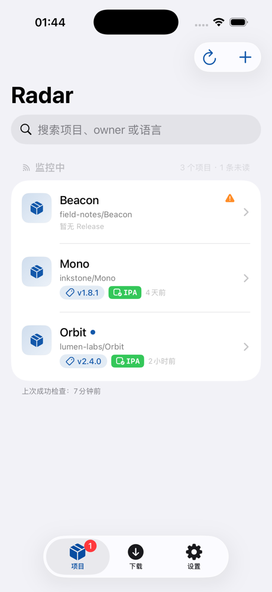
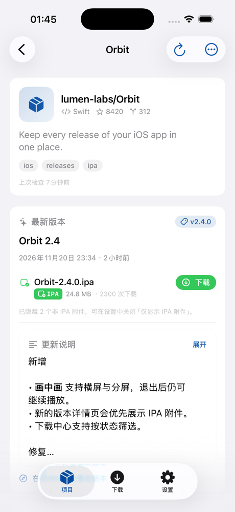
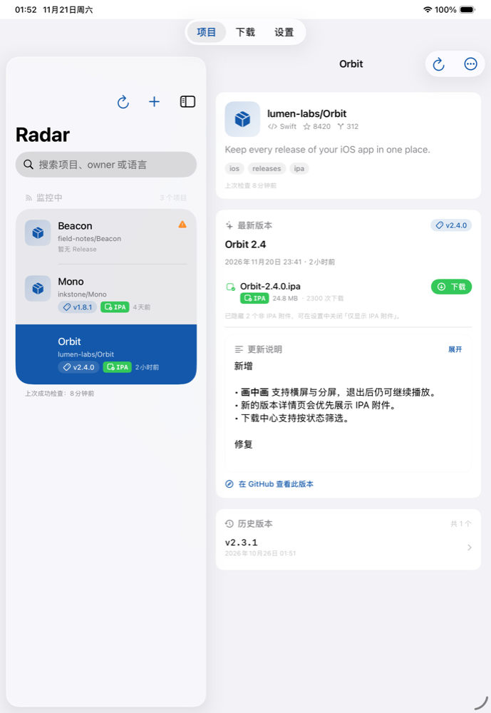

# Radar-ios

**Radar 的 iOS 客户端** —— 原生 SwiftUI GitHub Release 监控 App，把「有没有新版本、有没有 IPA」这件事放到手机上。

Radar macOS 版的孪生兄弟，专门监控 **IPA** 。


[](https://github.com/zrtnb6/Radar-ios/releases/latest)

---

## 目录

- [截图](#截图)
- [与 macOS 版的差异](#与-macos-版的差异)
- [功能特性](#功能特性)
- [IPA 识别规则](#ipa-识别规则)
- [安装](#安装)
- [移动端逻辑](#移动端逻辑)
- [架构](#架构)
- [工程结构](#工程结构)
- [本地构建](#本地构建)
- [GitHub Actions（可选）](#github-actions可选)
- [隐私与安全](#隐私与安全)
- [已知限制](#已知限制)
- [许可证](#许可证)

## 截图

iPhone 项目列表与详情（截图使用内置夹具数据）：




iPad 与横屏自动变成「列表 + 详情」分栏：



## 与 macOS 版的差异

| 维度 | Radar（macOS） | Radar-ios（本仓库） |
| --- | --- | --- |
| 监控目标 | DMG 磁盘映像 | **IPA 安装包** |
| 附件判定 | `isDMG` 布尔 | `AssetKind`：`ipa` / `dmg` / `archive` / `other` |
| 下载落点 | `~/Downloads` | App 沙盒 `Documents/Downloads`，对「文件」App 可见 |
| 安装方式 | 拖入 Applications | 分享给 AltStore / Sideloadly / TrollStore 侧载 |
| 导航 | 两栏 `NavigationSplitView` + 菜单栏 | 三 Tab（项目 / 下载 / 设置），iPad 自动切「列表 + 详情」分栏 |
| 刷新 | 前台 60 秒轮询 + 6 小时检查 | 前台 5 分钟轻量检查 + `BGAppRefreshTask` 后台刷新 |
| 下载会话 | 默认 URLSession | **background URLSession**，切后台继续下 |
| 通知 | `NSApplication` 通知 + 菜单栏角标 | 本地通知 + App 图标角标 + 点按深链 |
| 其他 | 开机自启、菜单栏 | URL Scheme `radar://`、文件共享、分享面板 |

## 功能特性

- **纯原生**：Swift / SwiftUI / SwiftData，没有 WebView 主界面，也不带第三方依赖
- **IPA 一等公民**：附件按扩展名识别（大小写不敏感、不信任 Content-Type），IPA 置顶、绿色徽标高亮
- **仅显示 IPA**：设置里默认开启，只留下能装的包；关掉后 DMG / ZIP 仍可见但会明确标注「iOS 无法安装」
- **App 内下载**：点击才下载，行内进度、取消、失败重试；同名文件自动追加 ` 2`、` 3`
- **保存到「文件」**：IPA 落在 `文件 → 我的 iPhone → Radar → Downloads`，长按即可分享给侧载工具
- **新版本通知**：同一 Release 只提醒一次；通知正文直接告诉你「已附带 IPA」还是「暂无 IPA」
- **深链**：点通知直接进入对应项目；也支持 `radar://repo/zrtnb6/Radar-ios` 从 Safari / 快捷指令跳转
- **令牌支持**：GitHub PAT 存 Keychain（`AfterFirstUnlock`，后台刷新也能读），`GET /rate_limit` 一键验证配额
- **限流处理**：读取 `Retry-After` / `X-RateLimit-Reset`，限流窗口内自动暂停检查并给出提示
- **首次添加即基线**：添加项目时把历史版本全部标为已读，不会被旧版本轰炸
- **搜索与批量操作**：按仓库名 / owner / 语言搜索；左滑删除、标为已读；长按查看更多操作

## IPA 识别规则

判定只看文件名扩展名，`App 1.2.0 (build 8).IPA` 这种带空格、括号、大写的写法同样命中：

| 扩展名 | 类型 | iOS 上可安装 | 展示位置 |
| --- | --- | --- | --- |
| `ipa` | IPA 安装包 | ✅ | 附件区最上方，绿色 IPA 徽标 |
| `archive`（zip / tar / gz / 7z…） | 压缩包 | ❌ | 仅「仅显示 IPA」关闭时出现 |
| `dmg` | DMG 磁盘映像 | ❌ 附带说明文字 | 同压缩包 |
| 其它 | 其他文件 | ❌ | 同上 |

Release 里一个 IPA 都没有时，详情页会明确写「该版本没有 IPA 附件」，而不是给一个空白区域。

## 安装

上 [Releases](https://github.com/zrtnb6/Radar-ios/releases/latest) 下最新 IPA：

```
https://github.com/zrtnb6/Radar-ios/releases/download/v1.0.0/Radar-ios-1.0.0-unsigned.ipa
```

| 项 | 值 |
| --- | --- |
| 体积 | 653 KB（668,320 字节） |
| 架构 | `arm64`（真机） |
| 最低系统 | iOS 17.0 |
| Bundle ID | `com.releaseradar.ios` |
| 签名 | 无 |

仓库内也留了一份构建产物：[`dist/Radar-ios-1.0.0-unsigned.ipa`](dist/Radar-ios-1.0.0-unsigned.ipa)，与 Release 资产同一文件。

未签名 IPA 不能直接双击安装，需要侧载工具用你自己的证书重签：

1. **AltStore / SideStore**：把 IPA 放进「我的 App」，用 Apple ID 重签安装。
2. **Sideloadly**（Windows / macOS）：拖入 IPA，填 Apple ID，Start。
3. **TrollStore**（仅支持的系统版本）：直接安装，无需重签。

用免费 Apple ID 侧载的有效期是 7 天，到期需重新签名；付费开发者账号为 1 年。Radar 不提供企业证书，也不做自动更新。

## 移动端逻辑

移动端不是把桌面布局缩小，而是把 iOS 的生命周期重新接了一遍：

| 场景 | 处理方式 |
| --- | --- |
| 冷启动 | 读 SwiftData → 注入默认项目 `zrtnb6/Radar-ios`（只注入一次）→ 前台检查按「上次检查时间 + 间隔」决定是否请求 |
| 切到后台 | 停掉前台轮询任务，向 `BGTaskScheduler` 排下一次后台刷新 |
| 后台唤醒 | `BGAppRefreshTask` 执行一次全量刷新，完成/超时都保证只回调一次 `setTaskCompleted` |
| 回到前台 | 重新启动轮询、恢复后台下载任务状态、补一次检查、同步图标角标 |
| 下载中切后台 | 走 background URLSession（`sessionSendsLaunchEvents`），系统接管传输；进程被回收后重新启动仍能从 UserDefaults 恢复「下载中」列表与目标文件名 |
| 后台会话不可用 | 后台传输守护进程连不上（未签名的开发包、模拟器）时自动降级到前台会话重试一次，仍失败才报错，不会「点了下载没反应」 |
| 下载完成 | 文件同步落到 `Documents/Downloads`；下载器的 `didFinishDownloadingTo` 里完成移动，避免临时文件被系统清掉 |
| 通知点按 | `NotificationService` 广播 → `AppState` 切到「项目」Tab、推进导航栈、定位 Release、清未读 |
| 大字体 / 横屏 | 全部使用动态字体与自适应布局；iPhone 竖屏单列，iPad 与横屏走 `NavigationSplitView` |
| 网络抖动 | 单仓库失败只标记自己的 `lastError`，其它仓库继续；缓存保留，界面不会清空 |
| 令牌读取 | Keychain `kSecAttrAccessibleAfterFirstUnlock`，锁屏状态下的后台刷新也能带认证 |

## 架构

| 能力 | 实现 |
| --- | --- |
| 数据持久化 | SwiftData：`Repository`、`Release`、`Asset`（含 `kindRaw`）、`NotificationEvent` |
| GitHub 访问 | `URLSession` + REST API `v2022-11-28`，30 秒超时，`User-Agent: Radar-iOS/1.0` |
| 附件类型 | `AssetKind.detect(fileName:)`，扩展名匹配 + 排序权重 |
| 更新判断 | Release ID / Tag / 发布时间 / Prerelease→正式；仅改 Notes 不算新版本 |
| 通知去重 | 持久化 `NotificationEvent`，同一 Release 只建一次事件 |
| 并发控制 | 每批 3 个仓库并发，失败隔离 |
| 下载策略 | 只接受 `https://github.com` 直链，拒绝内嵌账号、控制字符与路径穿越；后台会话不可用时降级到前台会话 |
| 后台任务 | `BGAppRefreshTask` + `TaskCompletionGuard`（NSLock 保证只完成一次） |
| 状态管理 | `AppState`（导航 / 角标 / Toast）+ `SyncService`（拉取与落库）+ `DownloadManager`（下载与分享） |

## 工程结构

```text
Radar-ios/
├── Sources/
│   ├── App/                      # 入口、AppDelegate（BGTask / 后台会话）、AppState、设置项
│   ├── Models/                   # Repository / Release / Asset / NotificationEvent
│   ├── Services/
│   │   ├── GitHub/               # DTO、客户端、URL 解析、配额、错误文案
│   │   ├── Release/              # AssetKind（IPA 判定）、ReleaseDetector
│   │   ├── Download/             # 下载策略 + background URLSession 下载器
│   │   ├── Sync/                 # SyncService、前台调度、后台刷新
│   │   ├── Notification/         # 本地通知、角标、点按回调
│   │   ├── Persistence/          # ModelContainer、默认项目
│   │   └── Security/             # Keychain
│   ├── DesignSystem/             # 颜色 / 间距 / 字体 / 通用组件
│   ├── Features/                 # 列表、详情、附件行、下载中心、添加、设置
│   └── Utilities/
├── Resources/Assets.xcassets/    # AppIcon（单尺寸 1024，无 alpha）
├── Support/Info.plist            # 后台模式、文件共享、URL Scheme
├── Documentation/GenerateIcon.swift
├── Scripts/build-ipa.sh          # 本地归档 + 打包未签名 IPA
├── dist/                         # 交付的 IPA
└── Radar.xcodeproj               # target 名 Radar，产物 Radar.app
```

## 本地构建

要求：Xcode 15+（建议更新），macOS 14+，iOS 17 SDK。

```bash
git clone https://github.com/zrtnb6/Radar-ios.git
cd Radar-ios
open Radar.xcodeproj     # 选自己的 Team 即可真机运行
```

命令行出未签名 IPA：

```bash
./Scripts/build-ipa.sh          # 输出 dist/Radar-ios-<版本>-unsigned.ipa
./Scripts/build-ipa.sh --clean  # 清掉中间产物后重来
```

脚本做的事：`xcodebuild archive`（`CODE_SIGNING_ALLOWED=NO`）→ 取 `Products/Applications/Radar.app` → `ditto` 进 `Payload/` → `zip` 成 `.ipa` → 打印体积、架构、最低系统版本。

App 图标由 `Documentation/GenerateIcon.swift` 程序化生成（品牌蓝底 + 两道扫描弧 + 绿色命中点 + 下载箭头）：

```bash
swiftc -O Documentation/GenerateIcon.swift -o /tmp/genicon
/tmp/genicon Resources/Assets.xcassets/AppIcon.appiconset/icon_1024.png
```

### 用夹具跑界面

DEBUG 构建内置了一套夹具数据，不消耗 GitHub 配额也能检查列表、详情、IPA 附件与设置的排版：

```bash
xcrun simctl launch <device-udid> com.releaseradar.ios --ui-fixtures            # 列表
xcrun simctl launch <device-udid> com.releaseradar.ios --ui-fixtures --ui-open=Orbit      # 指定仓库详情
xcrun simctl launch <device-udid> com.releaseradar.ios --ui-fixtures --ui-tab=settings    # 设置
```

## GitHub Actions（可选）

`.github/workflows/build-ipa.yml` 支持两种触发：手动 `workflow_dispatch`，或推 `v*` tag（构建完自动附到 Release）。用的也是 `Scripts/build-ipa.sh`，产物通过 `actions/upload-artifact` 里的 `*.ipa` 交付，本地有 Xcode 时优先本地构建即可。

## 隐私与安全

- Token 只存 Keychain，不写数据库、日志、UserDefaults，也不上传
- 不读取 Star 列表，不自动下载、不自动安装、不执行 Release 里的任何脚本
- 所有 GitHub 访问走 HTTPS REST API，不做高频轮询；后台刷新交给系统调度
- 下载请求不携带 Token，避免认证头跟着 302 跳到 CDN 第三方主机
- 无账号体系、无遥测、无第三方 SDK；仓库与版本数据只在本机 SwiftData 中

## 已知限制

- 未附带自动化测试 target；仓库 URL 解析、下载策略、附件判定沿用 macOS 版已通过 47 项测试的实现，iOS 侧靠编译期检查与真机手测
- 未签名 IPA 需要自行侧载重签，证书 7 天 / 1 年到期后要重装
- 直接跑未签名开发包时，后台下载会降级为前台会话（切后台可能被挂起）；用 AltStore 等工具重签安装后后台下载正常
- 后台刷新由系统调度，最早约 15 分钟后执行，实际时机取决于电量、使用频率与低电量模式
- 每个仓库最多缓存最近 30 个 Release，历史区展示全部已缓存版本，未做分页「加载更多」
- 私有仓库需自备 Fine-grained PAT（`Contents` / `Metadata` 读权限），未实现 OAuth 设备流登录
- 下载不做断点续传：失败后从头重下；附件只面向公开仓库直链
- 没有 Widget、没有 watchOS 端；通知为本地通知，不接 APNs 推送服务

## 许可证

[MIT License](LICENSE) © 2026 zrtnb6

macOS 版见 [zrtnb6/Radar](https://github.com/zrtnb6/Radar)。
